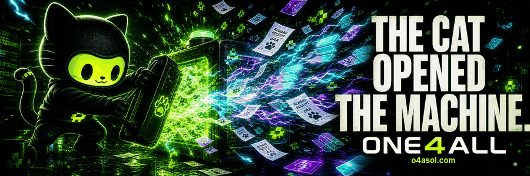

<p align="center">
  <a href="https://o4asol.com/">
    
  </a>
</p>

<h1 align="center">meet omni. get o4A.</h1>

<p align="center">
  <strong>a black-hooded cat who fixes things, and the Solana coin named after his crew.</strong>
</p>

<p align="center">
  <a href="https://o4asol.com/"><strong>VISIT OMNI</strong></a>
  · <a href="https://o4asol.com/world">THE UNIVERSE</a>
  · <a href="https://o4asol.com/talk">TALK TO OMNI</a>
  · <a href="https://x.com/o4Asol">X</a>
  · <a href="https://t.me/o4asol">TELEGRAM</a>
  · <a href="https://discord.gg/z29kkT95Td">DISCORD</a>
</p>

```text
 /\_/\
( o.o )   chain says yes.
 > w <    omni writes it down.
```

ONE4ALL (`o4A`) is a **Solana revenue-share memecoin** with one character at its
centre: **Omni**, a black-hooded cat with an acid-green face. Holders may receive
SOL when the protocol distributes rewards. Some rounds pay nothing, and rewards
vary and are not guaranteed.

You can enjoy Omni, his home, the memes and the tools without owning any o4A.

This repository is the public window: what the project is, how it is built and
where its limits are. The site's source and every key live somewhere else.

## what you can do on o4asol.com

| place | what happens there |
| --- | --- |
| [**Omni's home**](https://o4asol.com/) | Omni's living room on the homepage. What he did lately, the live project numbers, how to buy safely, and the public wallets. |
| [**The Universe**](https://o4asol.com/world) | A wall of rooms, one per home. Claim a room, dress your own Omni and chat live with other visitors. No wallet needed to look around. |
| [**Talk to Omni**](https://o4asol.com/talk) | Send Omni a message. He answers from his public record, and other visitors never see what you wrote. |
| [**Meet Omni**](https://o4asol.com/omni) | The page behind the sticker QR code: who Omni is and how to check the real token. |
| [**Pulse**](https://o4asol.com/pulse) | Public numbers with their sources attached. |
| [**Wall of Legends**](https://o4asol.com/build) | 256 places on one Omni for supporter art. In preview: bids are not open yet. |
| **PFP maker and memes** | Dress Omni, save a full-size picture, grab a meme. Free. |
| [**Rewards & Risks**](https://o4asol.com/rewards) | How the SOL part works and what can go wrong, in plain words. |

## one cat. zero keys.

Omni is an AI-written character. He reads public, verified project facts and
writes about them with his reasoning shown. He does not hold a key, sign a
transaction or move funds. Money, deployments and tokenomics stay with the
project owner.

- **Receipts or silence.** Every public number is verified and fresh, marked
  stale with its age, or shown as unavailable. Nothing is invented to fill a gap.
- **Visitors keep their keys.** Looking around never needs a wallet. The site
  never asks for a recovery phrase or private key.
- **Deterministic first.** Reads, freshness, limits and duplicate checks are
  plain code. A model only writes words, and words never become a transaction.

The longer version: [how it's built](ARCHITECTURE.md) and
[what it can and cannot do](TRUST.md).

## know the real cat

Names and tickers can be copied. The mint cannot.

```text
5BoCYsrqTucqoceJqq8oZbkmrpuzutDsTUkvtTteRREV
```

Check it on [o4asol.com](https://o4asol.com/) or
[Solscan](https://solscan.io/token/5BoCYsrqTucqoceJqq8oZbkmrpuzutDsTUkvtTteRREV)
before any swap. Live reward figures belong on their sources:
[RevShare](https://app.revshare.ltd/token/5BoCYsrqTucqoceJqq8oZbkmrpuzutDsTUkvtTteRREV)
and [DexScreener](https://dexscreener.com/solana/8roivuolyzbyyxqcfg1bs5upro4dc6wxjpyz8duzbhpk).
This repo never freezes a changing number.

## read more

| file | what it is |
| --- | --- |
| [NOW.md](NOW.md) | What is live today |
| [LITEPAPER.md](LITEPAPER.md) | The short litepaper, in plain words |
| [LITEPAPER-FULL.md](LITEPAPER-FULL.md) | The long version, with sources and open questions |
| [ARCHITECTURE.md](ARCHITECTURE.md) | How a public fact becomes something Omni says |
| [TRUST.md](TRUST.md) | What Omni can and cannot do |
| [MEDIA-KIT.md](MEDIA-KIT.md) | Official names, links and art |
| [BRAND-USE.md](BRAND-USE.md) | What you may do with the art |
| [SECURITY.md](SECURITY.md) | Reporting a vulnerability privately |
| [Artwork repo](https://github.com/o4a-sol/one4all-meme-assets) | Public meme files with their source records |

## pull up

- **Website:** [o4asol.com](https://o4asol.com/)
- **X:** [@o4Asol](https://x.com/o4Asol)
- **Telegram:** [o4asol](https://t.me/o4asol)
- **Discord:** [the o4A lab](https://discord.gg/z29kkT95Td)
- **X Community:** [ONE4ALL](https://x.com/i/communities/1930582873452482755)

---

<p align="center"><strong>memecoin. cute cat. entertainment only. not financial advice.</strong><br>
the price can fall to zero, and no payout, amount or schedule is promised.</p>
<p align="center"><code>// o4A</code></p>
